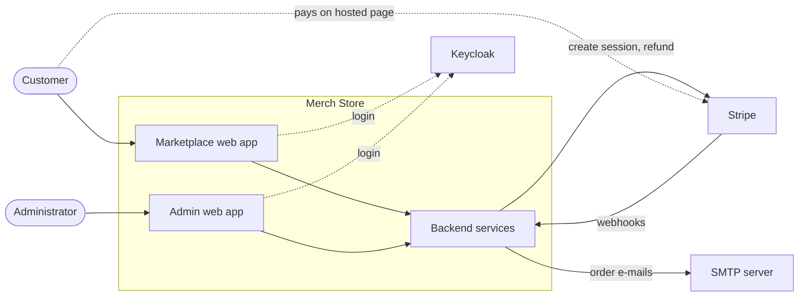
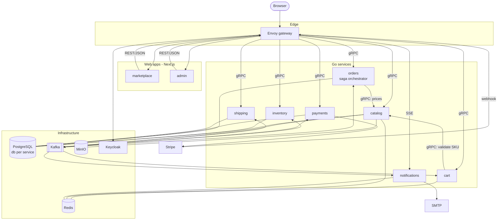
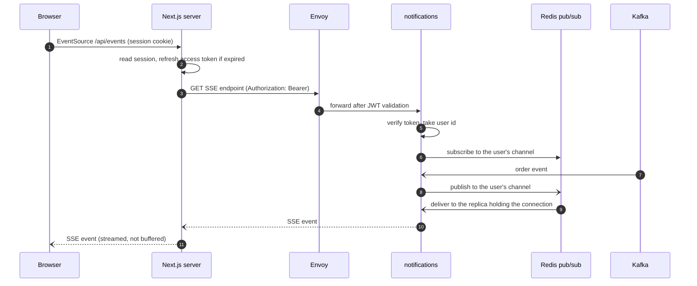
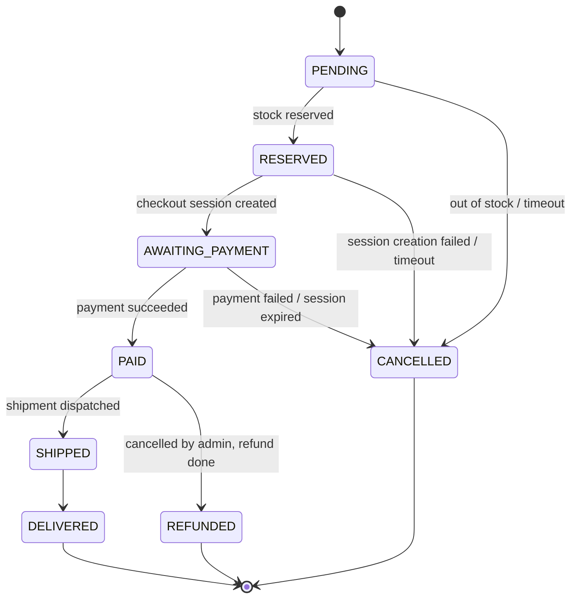
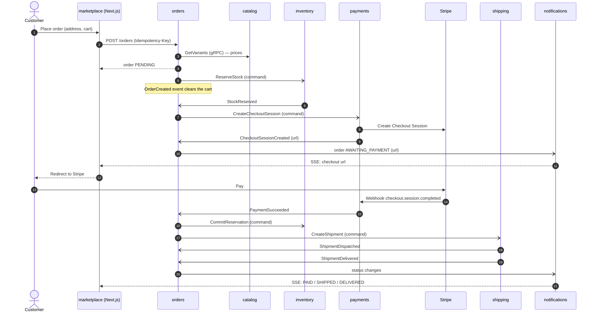

# Merch Store — High-Level Architecture

Status: draft v1. Individual decisions are recorded in [`adr/`](adr/).

## 1. Purpose and goals

Merch Store is an online shop for merchandise (t-shirts, mugs, pens). Customers browse a catalog, fill a cart, pay through Stripe, and follow their orders. An administrator manages products, stock, orders and payments in a separate admin panel.

The project is a pet project with two explicit goals:

- **Industry-like structure and process.** The codebase, contracts, deployment and workflow should look like a product built by a professional team.
- **Parallel work without interference.** Component and package boundaries must let several developers work on different services at the same time.

### In scope

- Catalog with product variants (SKU), images, search and filters.
- Guest and user carts, checkout, payment through Stripe (test mode).
- Order tracking with live status updates, e-mail notifications.
- Admin panel: products, stock, orders, payments, order cancellation with refund.

### Out of scope (possible extensions)

- `customers` service (profile, address book).
- Dedicated search engine (Elasticsearch/OpenSearch).
- Multi-currency, taxes, i18n, partial refunds, returns after delivery.
- Rate limiting at the gateway, service mesh / mTLS, GitOps (Argo CD), Vault.
- Real shipping carrier integration.

## 2. Technology stack

| Concern | Choice |
|---|---|
| Backend | Go microservices |
| Service-to-service transport | gRPC |
| Message bus | Kafka (KRaft mode) |
| Database | PostgreSQL (one database per service) |
| Cache / ephemeral state | Redis |
| Object storage | MinIO (S3-compatible) |
| Identity and access | Keycloak (OIDC) |
| API gateway | Envoy (gRPC-JSON transcoding, JWT validation) |
| Frontend | Next.js (JavaScript), Auth.js |
| Payments | Stripe Hosted Checkout + webhooks |
| E-mail | SMTP (Mailpit in dev) |
| Contracts | Protobuf managed with `buf`; OpenAPI generated from proto |
| Observability | OpenTelemetry, Prometheus, Grafana, structured logs |
| Deployment | docker-compose (infrastructure and Envoy), Kubernetes (Kind, staging) with Helm |
| CI/CD | GitHub Actions, images in GHCR |
| Task runner | Taskfile |

## 3. System context



## 4. Containers



### 4.1 Web applications

| App | Path | Audience | Notes |
|---|---|---|---|
| marketplace | `web/marketplace` | customers, guests | catalog, cart, checkout, orders page |
| admin | `web/admin` | role `admin` | products, stock, orders, payments, cancellation |

Both apps share a UI package and the JS API client generated from OpenAPI (`web/packages/`). The Next.js server side acts as the backend-for-frontend: it holds the session, attaches the access token to API calls, composes data for pages and proxies the SSE stream. Tokens never reach browser JavaScript.

### 4.2 Backend services

| Service | Responsibility | Owns | Sync API | Async |
|---|---|---|---|---|
| **catalog** | products, variants (SKU), categories, prices, image keys, search | Postgres, Redis cache, MinIO objects | public read API, admin CRUD, presigned upload URLs | publishes `catalog.events` |
| **inventory** | stock levels per SKU, reservations with TTL | Postgres | availability read, admin stock adjustments | consumes `inventory.commands`, publishes `inventory.events` |
| **cart** | guest and user carts (SKU + quantity only), merge on login | Redis | cart CRUD | consumes `orders.events` (clear cart on `OrderCreated`) |
| **orders** | order aggregate, state machine, saga orchestration, deadlines | Postgres | create/list/get order, admin list/cancel | publishes `orders.events` and command topics, consumes reply events |
| **payments** | Stripe wrapper: checkout sessions, webhooks, refunds, payment ledger | Postgres | admin payments read, Stripe webhook endpoint (HTTP) | consumes `payments.commands`, publishes `payments.events` |
| **shipping** | shipments behind a carrier provider interface; fake carrier advances statuses on a timer | Postgres | shipment read | consumes `shipping.commands`, publishes `shipping.events` |
| **notifications** | pushes status updates to UI over SSE, sends order e-mails | Redis pub/sub (no durable data) | SSE endpoint (HTTP) | consumes all `*.events` topics |

Admin functionality is exposed by each owning service as a separate gRPC service (for example `OrdersAdminService`) guarded by the `admin` role. There is no reporting service; simple joins are done in the admin app's server side.

## 5. Communication

### 5.1 External API

- Envoy is the single entry point. It routes by host: API, marketplace, admin, Keycloak.
- REST/JSON requests are transcoded to gRPC using HTTP annotations in the proto files. Proto is the single source of truth for contracts.
- Envoy validates Keycloak JWTs on protected routes and forwards the token downstream.
- Two endpoints are plain HTTP and described by hand-written OpenAPI: the Stripe webhook (`payments`) and the SSE stream (`notifications`).
- Envoy uses a static configuration (ConfigMap); no xDS control plane.

### 5.2 Synchronous calls (gRPC)

Used for queries that need an immediate answer:

- `orders → catalog`: authoritative prices and titles at checkout (stored as a snapshot in the order).
- `cart → catalog`: SKU validation when adding items.

A price coming from the browser or the cart is never trusted.

### 5.3 Asynchronous messaging (Kafka)

Used for every state transition that crosses a service boundary.

| Topic | Producer | Consumers |
|---|---|---|
| `orders.events` | orders | cart, notifications |
| `inventory.commands` | orders | inventory |
| `inventory.events` | inventory | orders, notifications |
| `payments.commands` | orders | payments |
| `payments.events` | payments | orders, notifications |
| `shipping.commands` | orders | shipping |
| `shipping.events` | shipping | orders, notifications |
| `catalog.events` | catalog | catalog cache invalidation, inventory (new SKU) |
| `<topic>.dlq` | consumers | manual inspection |

Rules:

- Messages are protobuf; schemas live in `shared` (no Schema Registry).
- Partition key is `order_id` for order-related topics, which preserves per-order ordering.
- Delivery is at-least-once. Producers use a **transactional outbox**; consumers are **idempotent** via a processed-messages table.
- Messages that cannot be processed go to a dead-letter topic.

### 5.4 Authentication and authorization

- One Keycloak realm `merch`, exported to JSON in the repository and imported on startup in every environment.
- Clients: `marketplace`, `admin`, plus one confidential client per service for client-credentials calls.
- Roles: `customer`, `admin`.
- Web apps use Authorization Code + PKCE through Auth.js; tokens are kept server-side in an encrypted httpOnly cookie.
- Envoy rejects unauthenticated requests on protected routes; every service verifies signature and roles again using `platform` middleware.
- Background work (saga steps, Kafka consumers) uses service tokens obtained with client credentials.
- Guests are identified by an anonymous session id and can only use catalog and cart.

### 5.5 Live updates (SSE)

The browser has no access token, so it does not connect to `notifications` directly. It opens the stream against its own Next.js app, which proxies it and attaches the token.



Rules:

- **Token expiry.** `notifications` validates the token on connect and closes the stream when the token expires. `EventSource` reconnects automatically and the Next.js server attaches a fresh token.
- **Events are hints, not the source of truth.** An event can be missed while the connection is down, so after every reconnect the frontend re-reads the order through the regular API.
- **Gateway.** The request timeout is disabled on the SSE route in Envoy so long-lived connections are not cut.
- **Scaling limit.** Envoy also fronts the marketplace, so the stream crosses it twice: browser → Envoy → Next.js → Envoy → `notifications`. Each connected user therefore holds two streams in Envoy, an inbound and an outbound socket in Next.js, and one connection in `notifications`. The stream is opened only on pages that wait for a status and closed when the user leaves them. This is acceptable at small scale, but the Next.js proxy is the weak link: its pods would have to scale with the number of open connections rather than with page load.
- **Evolution path.** At large scale the real-time path moves to its own public host (for example `events.<host>`) with a dedicated load balancer, and the browser connects to `notifications` directly using a short-lived one-time ticket issued by the Next.js server. The internal part (Kafka → `notifications` → Redis pub/sub) stays the same.

## 6. Data ownership

- One PostgreSQL instance per environment, one database and one DB user per service. A service never reads another service's tables.
- Migrations live inside the owning service.
- Data needed from another service is fetched over gRPC or copied from events (orders keeps a snapshot of price, title and shipping address).
- Money is stored as integer cents (`int64`), single currency USD.

| Store | Used by | Content |
|---|---|---|
| PostgreSQL | catalog, inventory, orders, payments, shipping | system of record, outbox, processed messages |
| Redis | cart | carts (guest carts with TTL) |
| Redis | catalog | product and listing cache, invalidated by catalog events |
| Redis | notifications | pub/sub fan-out between replicas |
| MinIO | catalog | product images, uploaded through presigned URLs |

Catalog model: `Product → Variant (SKU)`. Price and stock are attached to the SKU, and the SKU is the identifier used by cart, orders and inventory.

Inventory protects against overselling with an atomic conditional update (`UPDATE ... WHERE available >= qty`) inside a single transaction per order: all lines are reserved or none.

## 7. Order flow

### 7.1 State machine



### 7.2 Checkout saga (happy path)

`orders` is the orchestrator: it owns the state machine and sends commands; other services reply with events.



### 7.3 Failure handling and compensation

| Situation | Reaction |
|---|---|
| Not enough stock | order → `CANCELLED` |
| Payment failed or Stripe session expired | release reservation, order → `CANCELLED` |
| A saga step missed its deadline | background worker in `orders` finds overdue orders and compensates; for the payment step it first reconciles with the Stripe API so a paid order is never cancelled |
| Admin cancels a paid, not yet shipped order | Stripe refund + return stock, order → `REFUNDED` |
| Duplicate request or message | idempotency key on `POST /orders`; idempotent consumers; Stripe webhook events deduplicated by event id |

Reservations have a TTL of about 30 minutes, matching the Stripe Checkout session lifetime. A successful payment turns the reservation into a stock deduction.

`payments` treats Stripe webhooks as the source of truth, verifies their signature and keeps its own ledger (payments, refunds, received webhook log). Card data never enters the system.

## 8. Repository structure

Monorepo with independent Go modules tied together by `go.work`.

```
.
├── services/
│   ├── catalog/            # each service: own go.mod
│   ├── inventory/
│   ├── cart/
│   ├── orders/
│   ├── payments/
│   ├── shipping/
│   └── notifications/
├── shared/                 # module: API contracts and generated code
│   ├── proto/merch/<service>/v1/
│   ├── openapi/            # generated from proto + hand-written (webhook, SSE)
│   └── gen/go/
├── platform/               # module: cross-service infrastructure libraries
│   ├── logger/  closer/  config/  auth/  grpcx/
│   ├── kafka/  outbox/  migrator/  otel/  testcontainers/
├── web/
│   ├── marketplace/
│   ├── admin/
│   └── packages/           # shared UI, generated API client
├── deploy/
│   ├── compose/            # infrastructure for local development
│   ├── helm/               # generic service chart, values per service and environment
│   ├── envoy/
│   └── keycloak/           # realm export
├── tests/
│   └── e2e/                # Playwright scenarios against the whole system
├── docs/
│   └── architecture/
│       ├── README.md       # this document
│       └── adr/
├── .github/workflows/
├── CODEOWNERS
├── Taskfile.yml
└── go.work
```

### 8.1 Dependency rules

- A service imports only `shared` and `platform`, never another service.
- `platform` contains no business logic and does not import `shared`.
- Rules are enforced by `depguard` in CI; ownership is declared in `CODEOWNERS`.

### 8.2 Service layout

Every service follows the same layered (hexagonal) template:

```
services/<name>/
├── cmd/<name>/main.go
├── internal/
│   ├── domain/             # entities and rules, no external dependencies
│   ├── usecase/            # application logic, depends on interfaces it declares
│   ├── adapters/
│   │   ├── grpc/           # inbound handlers
│   │   ├── kafka/          # consumers, producers
│   │   ├── postgres/       # repositories
│   │   ├── redis/
│   │   └── clients/        # outbound gRPC / third-party clients
│   └── app/                # wiring, lifecycle, graceful shutdown
├── migrations/
├── Taskfile.yml
└── go.mod
```

Dependencies point inward: `adapters → usecase → domain`. Interfaces are declared by the consumer.

### 8.3 Contracts

- `buf` for linting, breaking-change detection and code generation.
- Packages are versioned: `merch.<service>.v1`.
- Generated Go code is committed to `shared`; CI fails if it differs from the proto sources.
- OpenAPI is generated from proto (`protoc-gen-openapiv2`); the JS client for the web apps is generated from it.

## 9. Configuration and secrets

- Environment variables only (12-factor), parsed and validated at startup by a `platform` package.
- Local: `.env` files with a committed example. Kubernetes: ConfigMap and Secret. Staging secrets come from GitHub Secrets at deploy time.

## 10. Observability

A cross-cutting requirement from the first service:

- OpenTelemetry tracing propagated through gRPC and Kafka headers.
- Prometheus metrics, Grafana dashboards.
- Structured logs carrying the trace id.

The storage stack (Tempo/Jaeger, Loki) is deployed in a dedicated phase.

## 11. Environments and deployment

| Environment | How | Purpose |
|---|---|---|
| local (compose) | docker-compose runs infrastructure (Postgres, Redis, Kafka, Keycloak, MinIO, Mailpit) and the Envoy gateway; Go services and web apps run from the host | fast development loop |
| local (Kind) | the whole system from the same Helm charts as staging | full-system check, end-to-end tests |
| staging | any Kubernetes cluster reachable from GitHub Actions through a kubeconfig secret | integration environment |

- Envoy is the entry point in every environment. In compose it reaches services and web apps on the host through `host.docker.internal`; routes and filters are the same as in the cluster, only upstream addresses differ (ADR 0011).
- One generic Helm chart for Go services with values per service and per environment.
- Infrastructure uses simple single-replica charts (Kafka in KRaft mode). In production these would be managed services or operators.
- Stripe webhooks are forwarded locally with the Stripe CLI.
- CI builds and tests only changed paths, pushes images to GHCR and runs `helm upgrade` for staging.

## 12. Development process

- Trunk-based development: short-lived branches, pull requests into `main`, Conventional Commits.
- Required checks: `golangci-lint` (including `depguard`), tests, `buf lint` and `buf breaking`, generated-code drift check, image build.
- Test levels:
  - unit — `domain` and `usecase`;
  - integration — adapters against real dependencies with testcontainers;
  - end-to-end — a few browser scenarios (Playwright, `tests/e2e/`) against the whole system in Kind. Unit and integration tests live inside each service; end-to-end tests belong to no service and talk to the system only through the browser and the public API. The Stripe hosted page is not automated: the scenario stops at the redirect and the payment is simulated with a test webhook.
- `Taskfile.yml` in the root includes per-service task files: code generation, lint, tests, migrations, compose up, deploy to Kind. Tool versions are pinned in the repository.

## 13. Implementation phases

The marketplace frontend is not a separate phase: it starts in phase 1 and grows with every backend phase, so each phase ends with a feature usable in the browser.

| # | Phase | Backend | Marketplace frontend | Done when the end-to-end test shows |
|---|---|---|---|---|
| 1 | **Walking skeleton** | `platform`, `shared`, and `catalog` taken through the whole path: Envoy, Keycloak, Postgres, compose, Kind, CI | app scaffold, generated API client, login through Keycloak, one page listing products from `catalog` | a user logs in and sees products |
| 2 | **cart** | guest carts, merge on login | product page, cart page | a guest fills a cart and keeps it after login |
| 3 | **orders + inventory** | order state machine, outbox, reservation saga | checkout page (address, place order), orders page | an order is placed and stock is reserved; an order for an out-of-stock SKU is cancelled |
| 4 | **payments** | Stripe Checkout, webhooks, refunds | redirect to Stripe, success and cancel return pages | the order becomes `PAID` after a simulated Stripe webhook |
| 5 | **shipping** | fake carrier and shipment statuses | shipment status on the order page | the order reaches `DELIVERED` |
| 6 | **notifications** | SSE and e-mail | live status updates instead of page refresh | the status changes on the page without a reload; the order e-mail arrives in Mailpit |
| 7 | **admin panel** | admin RPCs in each service | `web/admin`: products, stock, orders, payments, cancellation | an admin creates a product that appears in the shop; an admin cancels a paid order and it becomes `REFUNDED` |
| 8 | **observability** | tracing, metrics and log storage, dashboards | — | no new scenario; existing ones stay green |

Until phase 6 delivers SSE, the frontend polls the order to get the checkout URL and status changes.

Every phase is finished when its end-to-end check passes in Kind. Phases 1–6 extend one growing purchase scenario rather than adding a new test each time; phase 3 adds the out-of-stock scenario and phase 7 the admin scenarios, so the suite stays at a handful of tests.

## 14. Glossary

| Term | Meaning |
|---|---|
| **Product** | A sellable item as shown in the catalog (for example a t-shirt design). Owned by `catalog`. |
| **Variant / SKU** | A concrete purchasable version of a product (size, colour). Price and stock are attached to the SKU; it is the identifier shared by `catalog`, `cart`, `orders` and `inventory`. |
| **Inventory** | The name of the service (and its database) that keeps track of stock. It is not an entity: there is no `inventory` table or domain object. |
| **Stock** | The data the `inventory` service owns: the quantity of each SKU. Commands, events and entities use this word (`ReserveStock`, `StockReserved`, stock item). There is no separate `stock` service. |
| **Available / reserved** | The two parts of a SKU's stock: units that can still be sold, and units held for orders that are not yet paid. Units physically in the warehouse are the sum of both. |
| **Reservation** | A hold on stock for one order, with a TTL. It is committed when the order is paid and released when the order is cancelled or the TTL expires. |
| **Saga** | The multi-service order process coordinated by `orders`: reserve stock, take payment, ship. |
| **Command** | A message asking one service to do something (`inventory.commands`). Sent by the orchestrator. |
| **Event** | A message stating that something has happened (`inventory.events`). Published by the service that owns the fact. |
| **Compensation** | An action that undoes an earlier saga step, such as releasing a reservation or refunding a payment. |
| **Outbox** | A table written in the same transaction as the business change; a relay publishes its rows to Kafka, so a state change and its message cannot diverge. |
| **Snapshot** | A copy of another service's data taken at a point in time, such as the price and title stored in an order. |
